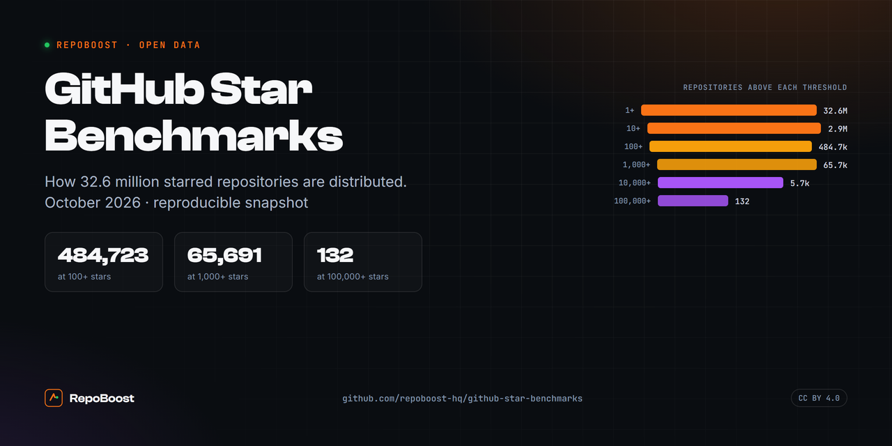
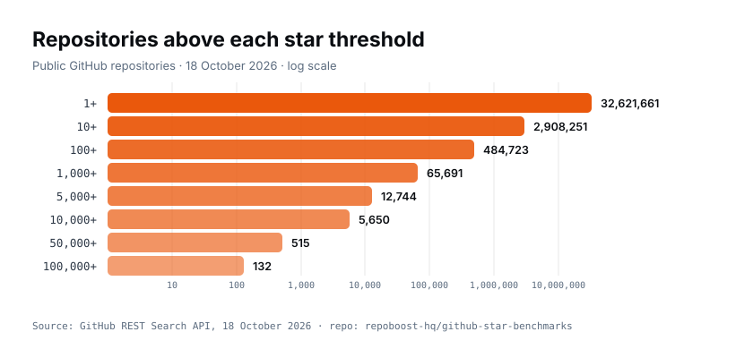
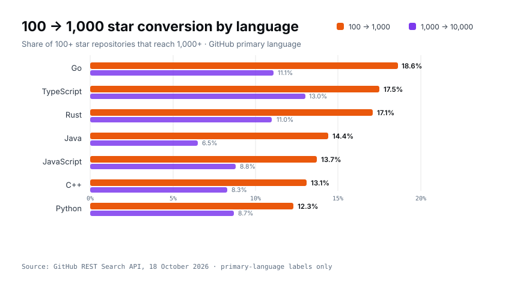
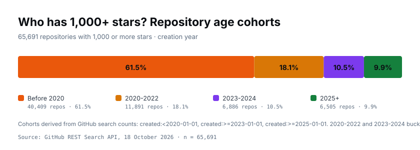

<div align="center">


# GitHub Star Benchmarks

**A reproducible snapshot of GitHub's star distribution.**
October 2026 · 32.6M starred repositories · CC BY 4.0

[](data/star-counts-2026-10-18.csv)
[](LICENSE)
[](reproduce.py)
[](reproduce.py)

</div>



## What this is

How many GitHub stars is actually good? Most answers are vibes. This repository is the data
behind a measured answer: how many public repositories sit above each star threshold, how those
counts change by language, and how old the repositories at the top really are.

One snapshot, one day, exact queries, reproducible in a few minutes. If you write about GitHub
growth, developer marketing or repository analytics, use the numbers and cite the snapshot.

| Star tier | Repositories | Share of starred repos | Roughly one in |
|---|---:|---:|---:|
| 1+ | 32,621,661 | 100% | 1 |
| 10+ | 2,908,251 | 8.92% | 11 |
| 100+ | 484,723 | 1.49% | 67 |
| 1,000+ | 65,691 | 0.20% | 497 |
| 5,000+ | 12,744 | 0.039% | 2,560 |
| 10,000+ | 5,650 | 0.017% | 5,774 |
| 50,000+ | 515 | 0.0016% | 63,343 |
| 100,000+ | 132 | 0.0004% | 247,134 |

**The headline:** 98.5% of repositories with any star never reach 100. Only 13.5% of the
repositories that reach 100 ever reach 1,000. The jump from "credible" to "widely used" is a
distribution problem, not a code-quality problem.

## Charts

<picture>
  <source media="(prefers-color-scheme: dark)" srcset="assets/star-thresholds-dark.svg">
  
</picture>

<picture>
  <source media="(prefers-color-scheme: dark)" srcset="assets/language-conversion-dark.svg">
  
</picture>

<picture>
  <source media="(prefers-color-scheme: dark)" srcset="assets/age-cohorts-dark.svg">
  
</picture>

<details>
<summary><b>Animated version</b> (bars grow into place)</summary>
<br>

</details>

## Language benchmarks

| Language | 100+ | 1,000+ | 10,000+ | 100 → 1,000 | 1,000 → 10,000 |
|---|---:|---:|---:|---:|---:|
| Python | 96,497 | 11,875 | 1,039 | 12.3% | 8.7% |
| JavaScript | 57,010 | 7,785 | 683 | 13.7% | 8.8% |
| TypeScript | 37,384 | 6,525 | 848 | 17.5% | 13.0% |
| Java | 26,672 | 3,852 | 250 | 14.4% | 6.5% |
| C++ | 25,965 | 3,402 | 284 | 13.1% | 8.3% |
| Go | 21,737 | 4,045 | 447 | 18.6% | 11.1% |
| Rust | 14,144 | 2,415 | 265 | 17.1% | 11.0% |

Python has the most popular repositories by volume; Go, TypeScript and Rust convert the
highest share of 100-star repositories into 1,000-star ones. Primary-language labels only.

## What is in this repository

| Path | What it is |
|---|---|
| `data/star-counts-2026-10-18.csv` | Repository count above each star threshold |
| `data/language-benchmarks-2026-10-18.csv` | Counts and conversion by language |
| `data/age-cohorts-2026-10-18.csv` | Age cohorts among 1,000+ and 100,000+ repositories |
| `data/top-100-repositories-2026-10-18.csv` | The 100 most-starred repositories in the snapshot |
| `assets/` | Banner, light/dark charts, animated chart, logo |
| `chart.svg` | Standalone log-scale chart |
| `DATA_DICTIONARY.md` | Field definitions and rounding notes |
| `CITATION.cff` | Citation metadata (CFF 1.2.0) |
| `reproduce.py` | Re-runs every query and writes a new snapshot |

## Methodology

- Endpoint: `GET https://api.github.com/search/repositories?q=<query>&per_page=1`
- Value used: the response field `total_count`.
- Threshold queries: `stars:>=N` for N in 1, 10, 100, 1,000, 5,000, 10,000, 50,000, 100,000.
- Language queries: `language:<name> stars:>=N` for Python, JavaScript, TypeScript, Java,
  C++, Go and Rust.
- Age queries: `stars:>=N created:>=YYYY-MM-DD` and `stars:>=N created:<2020-01-01`.
- Top-100 table: `stars:>1000 sort=stars order=desc`, first 100 results.
- Snapshot date: **18 October 2026**. Unauthenticated search allows 10 requests per minute;
  `reproduce.py` paces itself and accepts a `GITHUB_TOKEN` for a higher limit.

## Caveats

- `total_count` is GitHub's reported, approximate value. It moves as repositories are created,
  deleted, renamed or starred. Compare only within a single snapshot date.
- Language rows only include repositories GitHub classifies with that primary language.
  Unlabelled and multi-language projects are excluded.
- Conversion rates are ratios between cohorts, not causal effects.
- Counts are repositories, not people, and say nothing about code quality.

## Reproduce

```bash
python3 reproduce.py                        # unauthenticated, ~4 minutes
GITHUB_TOKEN=ghp_xxx python3 reproduce.py   # authenticated, faster
```

The script writes `data/star-counts-<snapshot>.csv` next to the existing snapshot.

## Cite this dataset

```bibtex
@misc{repoboost_star_benchmarks_2026,
  title        = {GitHub Star Benchmarks (October 2026)},
  author       = {RepoBoost},
  year         = {2026},
  howpublished = {\url{https://github.com/repoboost-hq/github-star-benchmarks}},
  note         = {Snapshot date: 2026-10-18. Data licensed CC BY 4.0.}
}
```

## From the team behind this dataset

<div align="center">

**Need a credible starting base?**

RepoBoost delivers stars, forks, watches and followers from aged accounts with real commit
history. Flat $30 per 1,000 actions, packages $30-$50, delivered gradually in 12-24 hours.
Every order starts with a conversation on Telegram.

<p align="center">
  <a href="https://buygithub.com/buy-github-stars/"></a>
  &nbsp;&nbsp;
  <a href="https://t.me/AlpinTamhas928"></a>
  &nbsp;&nbsp;
  <a href="https://buygithub.com/blog/how-many-github-stars-is-good/"></a>
</p>

</div>

## License

Data: [CC BY 4.0](https://creativecommons.org/licenses/by/4.0/). Code: MIT.
Attribute as: "RepoBoost, GitHub Star Benchmarks (October 2026), https://github.com/repoboost-hq/github-star-benchmarks".
